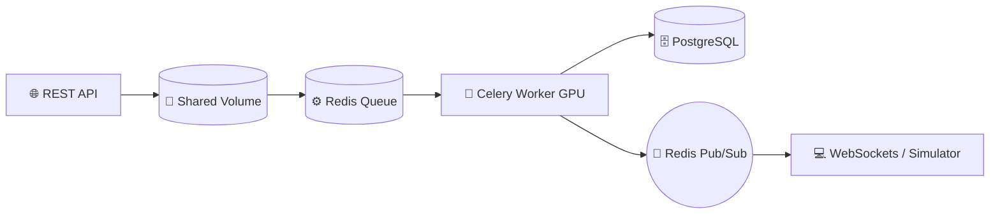
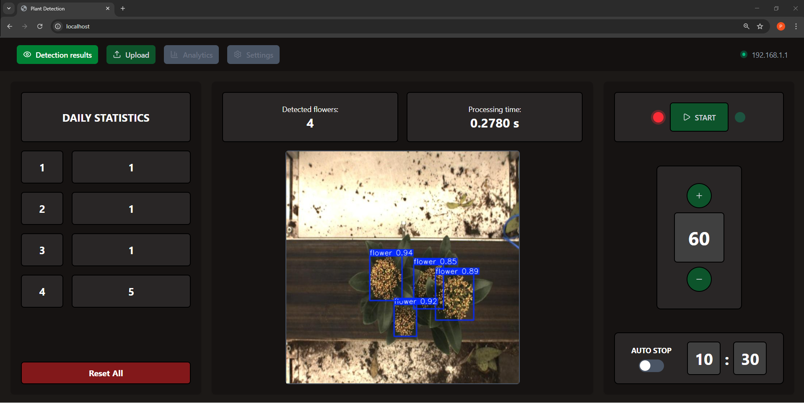
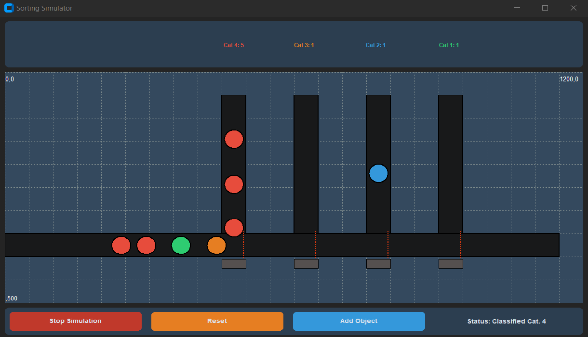

# 🌱 Automated Plant Classification System

An asynchronous, microservice-based system for plant classification 
and quality assessment using digital image processing and Machine Learning 
methods. 

This project provides an end-to-end processing pipeline: from image acquisition 
(via REST API) through GPU-accelerated inference (YOLO) to real-time 
result broadcasting (Redis Pub/Sub & WebSockets) mapped onto an interactive 
React dashboard and a physical process simulator.

---

## 🏗️ System Architecture

The system is fully containerized using **Docker** and built upon an 
**Event-Driven Architecture (EDA)** to ensure high throughput, temporal stability, 
and separation of concerns between I/O operations and heavy GPU computations.

<div align="center">
  
  <br>
  <em>
    Figure 1: High-level overview of the distributed microservice architecture.
  </em>
</div>

### 🔹 Core Components
* **Backend (FastAPI):** Acts as the orchestrator. Handles HTTP requests, 
stores incoming images on a shared volume, manages task states in PostgreSQL, 
and pushes jobs to the message broker.

* **Worker (Celery + PyTorch):** A dedicated GPU-accelerated process. 
Consumes jobs from the queue, performs object detection inference 
(e.g., YOLOv11n compiled to TensorRT FP16), and publishes the results.

* **Message Broker (Redis):** Serves a dual purpose: a task queue for Celery 
and a Pub/Sub engine for broadcasting inference results in real-time.

* **Database (PostgreSQL):** Stores processing metadata, bounding box coordinates, 
assigned quality classes, and inference latency metrics.

- **Shared Data Volume:** Acts as a bridge between the API, Worker, and Frontend. 
Instead of transmitting heavy image payloads through the message broker, files are 
stored directly on this volume, and microservices exchange only lightweight metadata 
(job IDs and file paths).

* **Frontend (React + Vite + Tailwind):** A Single Page Application (SPA) 
serving as an industrial HMI (Human-Machine Interface). Connects via WebSockets 
for live updates and provides a dashboard for daily statistics and visual result 
verification.

* **Process Simulator (Python / CustomTkinter):** A standalone module simulating 
a physical sorting conveyor belt, triggering image acquisitions, and acting upon 
the classification results received via Redis `Pub/Sub`.

---

## 📊 Key Results & Performance

The system's performance was rigorously evaluated against an industrial benchmark, 
focusing on detection accuracy, temporal stability, and end-to-end latency. 
The proposed system and detection models were evaluated on a custom dataset 
comprising 8,500+ images of *Skimmia japonica Rubella* with over 30,000 annotated 
flower bounding boxes. Benchmarks were performed on a hardware platform equipped 
with an NVIDIA GeForce GTX 1660 Ti (6 GB VRAM and 1536 CUDA Cores) GPU, 
Intel Core i7-9750H CPU and 32 GB RAM.

### 1. Detection Performance & Inference Speed Comparison

| Model Architecture | Format / Precision | mAP@50 | mAP@50–95 | Max F1-score (@ conf) | Mean Inference Time | Throughput (FPS) | Training Time |
| :--- | :---: | :---: | :---: | :---: | :---: | :---: | :---: |
| **SSD (Baseline)** | Native (.pt) | 0.961 | 0.697 | 0.944 (@ 0.221) | 20.6 ± 0.6 ms | 48.6 FPS | 137 min |
| **YOLOv11n** | Native (.pt) | 0.983 | 0.790 | 0.952 (@ 0.450) | 26.9 ± 3.4 ms | 37.1 FPS | 86 min |
| **YOLOv11n** | ONNX (.onnx) | 0.983 | 0.791 | 0.950 (@ 0.458) | 24.28 ± 3.9 ms | 41.2 FPS | - |
| **YOLOv11n (Target)** | TensorRT FP16 (.engine) | 0.983 | 0.789 | 0.951 (@ 0.448) | 22.45 ± 4.0 ms | 44.5 FPS | - |
| **YOLOv11n** | TensorRT INT8 (.engine) | 0.000 | 0.000 | 0.000 | 11.52 ± 1.4 ms | 86.8 FPS | - |
| **YOLOv12n** | Native (.pt) | 0.983 | 0.793 | 0.951 (@ 0.465) | 32.7 ± 5.8 ms | 30.6 FPS | 88 min |
| **YOLOv12n** | ONNX (.onnx) | 0.983 | 0.791 | 0.951 (@ 0.470) | 25.92 ± 4.4 ms | 38.6 FPS | - |
| **YOLOv12n** | TensorRT FP16 (.engine) | 0.983 | 0.790 | 0.950 (@ 0.460) | 22.34 ± 3.3 ms | 44.8 FPS | - |
| **YOLOv12n** | TensorRT INT8 (.engine) | 0.891 | 0.629 | 0.843 (@ 0.260) | 17.66 ± 4.7 ms | 56.6 FPS | - |
| **RF-DETR** | Native (.pt) | 0.982 | 0.752 | 0.957 (@ 0.459) | 30.9 ± 2.0 ms | 32.4 FPS | 525 min |

<br>

**Key Findings:**
- **Target Model Selection:** YOLOv11n in TensorRT FP16 format was selected 
for production deployment. It achieves state-of-the-art detection accuracy 
(mAP@50 = 0.983, mAP@50-95 = 0.789) while offering low and stable latency 
(22.45 ms / 44.5 FPS) and fast retraining capabilities (86 min).

- **Optimization Pipeline:** Conversion to ONNX architecture provided a 
noticeable performance boost (~41 FPS for YOLOv11n) with virtually no loss in 
precision, serving as a reliable intermediate step for further hardware-specific 
TensorRT compilations.

- **Quantization Susceptibility:** Post-Training Quantization (PTQ) to INT8 
without dedicated calibration resulted in complete loss of detection capability 
for YOLOv11n (mAP = 0.000) and severe degradation for YOLOv12n 
(mAP@50 dropped from 0.983 to 0.891), confirming that FP16 precision is optimal 
for deployment without Quality-Aware Training (QAT).

<br>

**Model Exclusions for TensorRT Optimization:**
While YOLO architectures were successfully compiled to TensorRT, the SSD and 
RF-DETR models were excluded from the hardware optimization pipeline for specific 
architectural and performance reasons:

- **SSD:** Despite offering the lowest initial inference time (~20.6 ms), the 
model demonstrated significantly inferior bounding box localization precision 
(mAP@50-95 of 0.697) compared to other evaluated architectures. Consequently, 
further efforts to quantize or accelerate it were deemed unjustified.

- **RF-DETR:** Although the conversion to `.onnx` and compilation to `.engine` 
were technically successful, the exported model stripped the internal 
post-processing layers. Instead of standardized bounding boxes, the compiled 
model returned raw output tensors requiring a complex, custom-built decoder 
module to be integrated into the microservice pipeline. Due to these deployment 
overheads, its evaluation was restricted to the native `.pt` PyTorch format.

### 2. Threshold Tuning & Business Impact

In industrial plant classification, flower counts are mapped into specific 
quality categories. The system was evaluated under two configurations: a 3-class 
system (e.g., 1–6, 7–12, ≥ 13 flowers) and a more rigorous 4-class system 
(1–5, 6–9, 10–12, ≥ 13 flowers).

Fine-tuning the prediction confidence threshold to maximize *Balanced Accuracy* 
rather than raw *Accuracy* significantly reduces the risk of underclassifying 
high-value plants:

- **3-Class Classification (YOLOv11n):** Adjusting the confidence threshold 
from 0.43 (Max Accuracy: 96.8%) to 0.39 (Max Balanced Accuracy: 96.7%) 
increased the **Recall** for the highest quality class (≥ 13 flowers) 
from 83.3% to 91.7%, with virtually no impact on overall classification accuracy.

- **3-Class Classification (RF-DETR):** Adjusting the threshold from 0.53 
(Accuracy: 96.9%, Recall ≥ 13: 58.3%) to 0.23 boosted premium Recall 
to 100%, but at the expense of lowering overall accuracy to 93.6%.

- **4-Class Classification Impact:** Transitioning to a stricter 4-class 
configuration naturally narrows the decision boundaries, leading to a slight 
drop in overall accuracy. However, confusion matrix analysis revealed that 
classification errors are highly localized - occurring almost exclusively 
between adjacent classes. Adjusting the threshold for Balanced Accuracy 
(e.g., to 0.34 for YOLOv11n) not only preserved a high 91.7% Recall for the 
premium class (≥ 13 flowers), but also improved the classification of the 
sub-premium class (10–12 flowers). It successfully shifted misclassifications 
upward to higher-value adjacent bins, yielding a more profitable error 
distribution with only a negligible drop in overall accuracy (from 91.5% to 91.0%).

### 3. End-to-End System Performance & Load Stability

Integration tests were conducted across the complete distributed pipeline



- **Baseline p95 E2E Latency:** ~170 ms under unloaded conditions, ensuring 
rapid system response times.

- **Max Stable Throughput:** System maintains stable operation at up to ~13–14 
requests/second (~75 ms interval).

- **Overload Threshold:** At a 50 ms request interval (~20 req/s), task queue
accumulation occurs, leading to continuous latency degradation.

<br>

### 🖼️ Graphical Interfaces

**📱 Industrial HMI Dashboard (React + Vite)** -
The web frontend serves as an operator dashboard (Human-Machine Interface) 
for real-time process monitoring, historical statistics, diagnostic latency 
tracking, and visual verification of detected bounding boxes.

<div align="center">
  
  <br>
  <em>
    Figure 2: React-based HMI Dashboard displaying Daily Quality Statistics (left), 
    Live Detection Result & Processing Diagnostics (center), and Belt Control Panel (right).
  </em>
</div>

<br>
<br>

**🏭 Sorting Line Simulator (Python / CustomTkinter)** -
A virtual simulation environment reflecting a physical conveyor belt system 
with 4 quality drop chutes, virtual photo-sensors, pneumatic actuators, and 
real-time Redis Pub/Sub communication.

<div align="center">
  
  <br>
  <em>
    Figure 3: Top-down view of the virtual conveyor belt simulator showing 
    color-coded plant objects passing sensors and being redirected to appropriate drop chutes.
  </em>
</div>

---

## 🛠️ Tech Stack

* **API & Orchestration:** Python 3.12, FastAPI, SQLAlchemy

* **Asynchronous Queue:** Celery, Redis

* **Machine Learning:** PyTorch, Ultralytics (YOLO), Roboflow (RF-DETR), NVIDIA TensorRT

* **Database:** PostgreSQL

* **Frontend:** React, Vite, Tailwind CSS, Nginx

* **Simulation:** Python, CustomTkinter, aiohttp

* **Infrastructure:** Docker, Docker Compose, NVIDIA Container Toolkit

---

## ⚙️ Prerequisites

To run the full stack with hardware acceleration, ensure your host machine 
meets the following requirements:
* **Docker** and **Docker Compose** installed.

* **NVIDIA GPU** with compatible proprietary drivers.

* **NVIDIA Container Toolkit** installed and configured (to allow Docker containers to access the GPU).

* **Python 3.12** (required only on the host machine if you intend to run the Process Simulator).

---

## 🚀 Getting Started

### 1. Clone the repository
```bash
git clone https://github.com/PatrykStrzalecki/plant_detection.git

cd plant_detection
```

### 2. Environment Variables

Create a `.env` file in the root directory. You can use the provided 
`.env.example` as a template to set up database credentials and port mappings.

### 3. Launch the Microservices

Start the core application stack (Backend, Worker, DB, Redis, and Frontend) 
using Docker Compose:

```bash
docker-compose up -d --build
```

> [!NOTE]
> The initial build might take a few minutes as it pulls the PyTorch CUDA runtime and Node.js Alpine images.

Once the containers are up, the services will be available at:
* Frontend (HMI Dashboard): http://localhost:80
* Backend API Docs (Swagger UI): http://localhost:8000/docs

---

## 🏭 Running the Process Simulator

The repository includes a virtual sorting line simulator designed to test the 
system's end-to-end latency and its ability to handle continuous industrial loads.

> [!IMPORTANT]
> The core microservice stack (specifically the Redis container) must be running before starting the simulator. The simulator connects to the Redis Pub/Sub channel on startup and will crash with a connection error if the broker is unreachable.

### 1. Install Simulator Dependencies

It is highly recommended to use a virtual environment:

```bash
# On Windows use python -m venv .venv
python3 -m venv .venv

# On Windows use: python .venv\Scripts\activate
source .venv/bin/activate  

pip install -r simulator/requirements.txt
```

### 2. Start the Simulator

From the root directory of the project, run:

```bash
# On Windows use python ./simulator/src/app.py
python3 ./simulator/src/app.py
```

The simulator will open a GUI where you can start the virtual conveyor belt. 
As virtual plants pass the "camera sensor", HTTP POST requests are fired 
to the Backend, and the assigned quality classes (returned via Redis) 
will dynamically trigger the corresponding sorting actuators.

---

## 🔄 Data Flow Overview

1. **Acquisition:** A physical camera (or the Simulator) posts an image 
to `/upload-image`.

2. **Orchestration:** The Backend saves the file to the shared `/data/input` 
volume, registers a PENDING task in PostgreSQL, and pushes the job ID to 
the Redis queue. It immediately returns an HTTP `202 Accepted`.

3. **Inference:** The Celery Worker picks up the job, loads the image from the 
shared volume, and runs inference on the GPU.

4. **Result Distribution:** The Worker saves the annotated image to `/data/output`, 
updates the DB to `SUCCESS`, and broadcasts a Done event via Redis `Pub/Sub`.

5. **Action & Visualization:**

    * The Frontend receives the event via WebSocket, fetching and displaying 
    the annotated image.

    * The Simulator reads the event directly from Redis and physically routes 
    the object to the correct bin.

---

## 📌 Status & Roadmap

This system was originally developed as part of a Master's Thesis research 
project evaluating the deployment feasibility, temporal stability, and business 
impact of various quantization strategies (FP16, INT8) on modern detection 
architectures in an industrial context.

- [x] Asynchronous API & GPU Worker integration.
- [x] Shared Volume implementation to reduce message payload overhead.
- [x] React-based industrial HMI dashboard.
- [x] Sorting process simulator.
- [ ] Direct PLC integration via Modbus TCP (Future Scope).