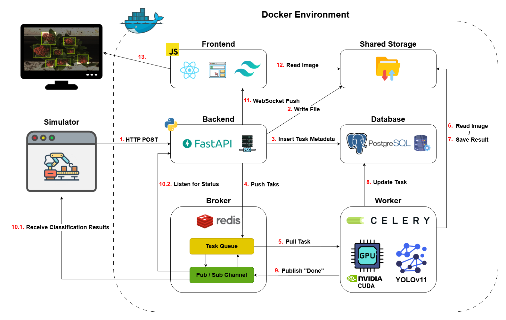

# 🌱 Automated Plant Classification System

An asynchronous, microservice-based system for plant classification 
and quality assessment using digital image processing and Machine Learning 
methods. 

This project provides an end-to-end processing pipeline: from image acquisition 
(via REST API) through GPU-accelerated inference (YOLO) to real-time 
result broadcasting (Redis Pub/Sub & WebSockets) mapped onto an interactive 
React dashboard and a physical process simulator.

---

## 🏗️ System Architecture

The system is fully containerized using **Docker** and built upon an 
**Event-Driven Architecture (EDA)** to ensure high throughput, temporal stability, 
and separation of concerns between I/O operations and heavy GPU computations.



### 🔹 Core Components
* **Backend (FastAPI):** Acts as the orchestrator. Handles HTTP requests, 
stores incoming images on a shared volume, manages task states in PostgreSQL, 
and pushes jobs to the message broker.

* **Worker (Celery + PyTorch):** A dedicated GPU-accelerated process. 
Consumes jobs from the queue, performs object detection inference 
(e.g., YOLOv11n compiled to TensorRT FP16), and publishes the results.

* **Message Broker (Redis):** Serves a dual purpose: a task queue for Celery 
and a Pub/Sub engine for broadcasting inference results in real-time.

* **Database (PostgreSQL):** Stores processing metadata, bounding box coordinates, 
assigned quality classes, and inference latency metrics.

- **Shared Data Volume:** Acts as a bridge between the API, Worker, and Frontend. 
Instead of transmitting heavy image payloads through the message broker, files are 
stored directly on this volume, and microservices exchange only lightweight metadata 
(job IDs and file paths).

* **Frontend (React + Vite + Tailwind):** A Single Page Application (SPA) 
serving as an industrial HMI (Human-Machine Interface). Connects via WebSockets 
for live updates and provides a dashboard for daily statistics and visual result 
verification.

* **Process Simulator (Python / CustomTkinter):** A standalone module simulating 
a physical sorting conveyor belt, triggering image acquisitions, and acting upon 
the classification results received via Redis `Pub/Sub`.

---

## 🛠️ Tech Stack

* **API & Orchestration:** Python 3.12, FastAPI, SQLAlchemy

* **Asynchronous Queue:** Celery, Redis

* **Machine Learning:** PyTorch, Ultralytics (YOLO), Roboflow (RF-DETR), NVIDIA TensorRT

* **Database:** PostgreSQL

* **Frontend:** React, Vite, Tailwind CSS, Nginx

* **Simulation:** Python, CustomTkinter, aiohttp

* **Infrastructure:** Docker, Docker Compose, NVIDIA Container Toolkit

---

## ⚙️ Prerequisites

To run the full stack with hardware acceleration, ensure your host machine 
meets the following requirements:
* **Docker** and **Docker Compose** installed.

* **NVIDIA GPU** with compatible proprietary drivers.

* **NVIDIA Container Toolkit** installed and configured (to allow Docker containers to access the GPU).

* **Python 3.12** (required only on the host machine if you intend to run the Process Simulator).

---

## 🚀 Getting Started

### 1. Clone the repository
```bash
git clone https://github.com/PatrykStrzalecki/plant_detection.git

cd plant_detection
```

### 2. Environment Variables

Create a `.env` file in the root directory. You can use the provided 
`.env.example` as a template to set up database credentials and port mappings.

### 3. Launch the Microservices

Start the core application stack (Backend, Worker, DB, Redis, and Frontend) 
using Docker Compose:

```bash
docker-compose up -d --build
```

> [!NOTE]
> The initial build might take a few minutes as it pulls the PyTorch CUDA runtime and Node.js Alpine images.

Once the containers are up, the services will be available at:
* Frontend (HMI Dashboard): http://localhost:80
* Backend API Docs (Swagger UI): http://localhost:8000/docs

---

## 🏭 Running the Process Simulator

The repository includes a virtual sorting line simulator designed to test the 
system's end-to-end latency and its ability to handle continuous industrial loads.

> [!IMPORTANT]
> The core microservice stack (specifically the Redis container) must be running before starting the simulator. The simulator connects to the Redis Pub/Sub channel on startup and will crash with a connection error if the broker is unreachable.

### 1. Install Simulator Dependencies

It is highly recommended to use a virtual environment:

```bash
# On Windows use python -m venv .venv
python3 -m venv .venv

# On Windows use: python .venv\Scripts\activate
source .venv/bin/activate  

pip install -r simulator/requirements.txt
```

### 2. Start the Simulator

From the root directory of the project, run:

```bash
# On Windows use python ./simulator/src/app.py
python3 ./simulator/src/app.py
```

The simulator will open a GUI where you can start the virtual conveyor belt. 
As virtual plants pass the "camera sensor", HTTP POST requests are fired 
to the Backend, and the assigned quality classes (returned via Redis) 
will dynamically trigger the corresponding sorting actuators.

---

## 🔄 Data Flow Overview

1. **Acquisition:** A physical camera (or the Simulator) posts an image 
to `/upload-image`.

2. **Orchestration:** The Backend saves the file to the shared `/data/input` 
volume, registers a PENDING task in PostgreSQL, and pushes the job ID to 
the Redis queue. It immediately returns an HTTP `202 Accepted`.

3. **Inference:** The Celery Worker picks up the job, loads the image from the 
shared volume, and runs inference on the GPU.

4. **Result Distribution:** The Worker saves the annotated image to `/data/output`, 
updates the DB to `SUCCESS`, and broadcasts a Done event via Redis `Pub/Sub`.

5. **Action & Visualization:**

    * The Frontend receives the event via WebSocket, fetching and displaying 
    the annotated image.

    * The Simulator reads the event directly from Redis and physically routes 
    the object to the correct bin.

---

## 📌 Status & Roadmap

This system was originally developed as part of a Master's Thesis research 
project evaluating the deployment feasibility, temporal stability, and business 
impact of various quantization strategies (FP16, INT8) on modern detection 
architectures in an industrial context.

- [x] Asynchronous API & GPU Worker integration.
- [x] Shared Volume implementation to reduce message payload overhead.
- [x] React-based industrial HMI dashboard.
- [x] Sorting process simulator.
- [ ] Direct PLC integration via Modbus TCP (Future Scope).